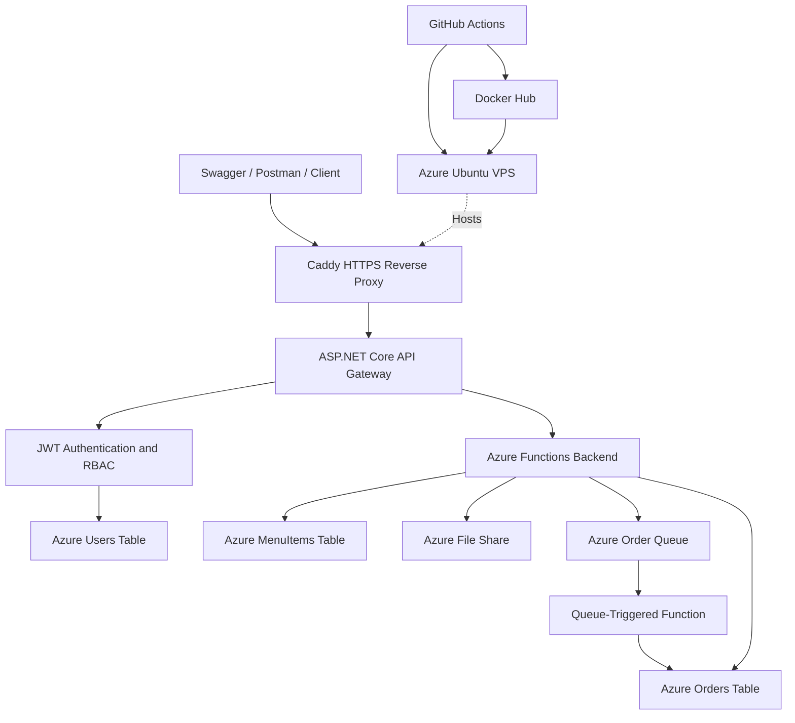

# CoffeeNChill — POE Part 3

**Cloud Development B | CLDV6212 | 2026**

**Group Members**
- Ayden Jordaan — ST10466857
- Yash Keshav — ST10449059

**Repository:** https://github.com/st10449059/CoffeeNChill-CLDV6212

**Live API:** https://coffeenchill-p3.southafricanorth.cloudapp.azure.com

**Swagger UI:** https://coffeenchill-p3.southafricanorth.cloudapp.azure.com/swagger

**Part 3 Video:** [ADD UNLISTED YOUTUBE LINK]

## Part 3 Overview

Part 3 of CoffeeNChill focuses on securing and deploying the canteen management system through a central API Gateway.

We developed an ASP.NET Core Web API using .NET 10 to provide a single entry point for the existing Azure Functions services. The Gateway introduces JWT authentication, role-based access control, request validation, Swagger documentation and centralised exception handling.

The application is hosted on an Azure Ubuntu Linux virtual machine. Docker Compose manages the application containers, while Caddy provides HTTPS access. We also implemented a GitHub Actions CI/CD pipeline that automatically builds, tests, publishes and deploys the application whenever changes are pushed to the main branch.

The earlier Part 1 and Part 2 implementations remain documented below this section. The deployment instructions in this Part 3 section apply to the final production system.

## 1. System Architecture

The production system consists of an ASP.NET Core Gateway, an Azure Functions backend, Azure Storage services and a Caddy reverse proxy.



Incoming HTTPS requests reach Caddy before being forwarded to the Gateway. The Gateway authenticates protected requests and communicates with the Azure Functions backend through an internal Docker network.

The Functions application handles menu operations, staff documents and order processing. Azure Storage provides persistent data storage and asynchronous queue-based processing.

Separating the Gateway from the backend allows us to apply authentication and authorisation consistently without exposing the individual Functions container directly to the public internet.

## 2. Technologies Used

| Technology | Purpose |
|---|---|
| C# and .NET 10 | Application development |
| ASP.NET Core Web API | Public API Gateway |
| Azure Functions | Backend operations |
| Azure Table Storage | User, menu and order records |
| Azure Queue Storage | Asynchronous order submission |
| Azure Files | Staff document storage |
| ASP.NET Core Identity PasswordHasher | Secure password hashing |
| JWT Bearer Authentication | Authentication and role-based access |
| Swagger / OpenAPI | API documentation and testing |
| Docker | Application containerisation |
| Docker Compose | Multi-container deployment |
| Docker Hub | Published container images |
| Ubuntu 24.04 LTS | VPS operating system |
| Azure Virtual Machines | Application hosting |
| Caddy | HTTPS reverse proxy |
| GitHub Actions | Automated CI/CD |
| Postman | API testing |

## 3. API Gateway

The Gateway project is located in `CoffeeNChill.Gateway`.

It uses controllers to organise API endpoints and DTO classes to handle incoming request data. The Gateway validates requests and forwards applicable operations to the Azure Functions backend through a configured HTTP client.

The implementation includes:

- Controller-based API routing.
- DTOs with request validation.
- XML comments used in Swagger documentation.
- JWT Bearer authentication.
- Customer, Staff and Admin access restrictions.
- Centralised exception-handling middleware.
- Standard HTTP response codes.
- Internal HTTP communication with Azure Functions.

The `Program.cs` file configures dependency injection, authentication, authorisation policies, Swagger and middleware.

The Gateway is deployed with `ASPNETCORE_ENVIRONMENT=Production`. Swagger is enabled separately using the `Swagger__Enabled` configuration setting.

### API Endpoints

| Method | Endpoint | Access |
|---|---|---|
| POST | `/api/auth/register` | Public |
| POST | `/api/auth/login` | Public |
| GET | `/api/menu` | Public |
| GET | `/api/menu/category/{category}` | Public |
| POST | `/api/menu` | Staff / Admin |
| PUT | `/api/menu/{category}/{id}` | Staff / Admin |
| DELETE | `/api/menu/{category}/{id}` | Staff / Admin |
| POST | `/api/orders/queue` | Public |
| GET | `/api/orders/{orderDate}/{orderId}` | Staff / Admin |
| PUT | `/api/orders/status` | Staff / Admin |
| GET | `/api/documents` | Staff / Admin |
| POST | `/api/documents/upload` | Staff / Admin |
| GET | `/api/documents/download/{fileName}` | Staff / Admin |
| DELETE | `/api/documents/{fileName}` | Staff / Admin |
| GET | `/api/admin/users/summary` | Admin |

The complete list of endpoints, request schemas and supported responses can be viewed through the deployed Swagger interface.

## 4. Authentication and Role-Based Access Control

Part 3 introduces authentication using JWT Bearer tokens and user profiles stored in the Azure `Users` table.

### Registration

The `/api/auth/register` endpoint creates Customer accounts. Registration requires a full name, email address and password.

Passwords are hashed using the ASP.NET Core Identity `PasswordHasher` before being stored in Azure Table Storage. The original password is not saved.

Public registration assigns the `Customer` role automatically. Users cannot select Staff or Admin privileges through the registration request.

### Login

The `/api/auth/login` endpoint verifies the submitted credentials and returns a signed JWT for successful authentication.

The JWT includes the authenticated user's identity and role. Tokens are signed using HMAC-SHA256, and the application validates the issuer, audience, signature and expiration.

Tokens expire after one hour.

### User Roles

| Role | Permissions |
|---|---|
| Customer | Public menu access and order submission |
| Staff | Protected menu, document and order management |
| Admin | Staff permissions and administrator-only reporting |

The application uses two authorisation policies:

- `StaffOnly`: permits Staff and Admin roles.
- `AdminOnly`: permits the Admin role.

Requests without valid authentication are rejected from protected endpoints. Authenticated users who lack the required role are also denied access.

### User Storage

The `Users` Azure Table stores each account's email, full name, password hash, role and creation date.

The current implementation uses the partition key `USERS` and an SHA-256-derived row key generated from the normalised email address. The user's original email and assigned role remain separate entity properties.

## 5. Order Processing Through the Gateway

Part 3 exposes the existing Azure Functions order-processing functionality through the public Gateway.

Customers can submit an order without logging in:

`POST /api/orders/queue`

The Gateway forwards the JSON payload to the Azure Functions order producer. The producer validates the order and places an appropriate message onto the Azure Storage queue.

A successful submission returns HTTP `202 Accepted`.

The queue-triggered Function processes the message and creates or updates the corresponding record in the `Orders` Azure Table.

The processing lifecycle follows:

**Received → Preparing → Ready → Collected**

Staff and Admin users can retrieve existing orders and access the protected order-status endpoint.

Because processing takes place asynchronously, the order may not be immediately available after submission. The client can retrieve the record again using the order ID and UTC order date.

## 6. Docker and Linux VPS Deployment

### Live Hosting Environment

| Configuration | Value |
|---|---|
| Hosting provider | Microsoft Azure |
| Virtual machine | `coffeenchill-p3-vm` |
| Region | South Africa North |
| Operating system | Ubuntu 24.04 LTS |
| VM size | Standard D2s v3 |
| Container runtime | Docker Engine |
| Container orchestration | Docker Compose |
| Reverse proxy | Caddy |
| Public protocol | HTTPS |

**Public URL:** https://coffeenchill-p3.southafricanorth.cloudapp.azure.com

The application runs using the following Docker Compose services:

- `gateway` — ASP.NET Core Web API.
- `functions` — Azure Functions backend.
- `caddy` — HTTPS reverse proxy.

The Gateway is accessible internally on the VPS through `127.0.0.1:7350`, while public requests enter through Caddy on ports 80 and 443.

The production Functions service is not directly published to the internet.

### Docker Hub Repositories

**Gateway image:** https://hub.docker.com/r/yashkeshav/coffeenchill-gateway

**Functions image:** https://hub.docker.com/r/yashkeshav/coffeenchill-functions

Both services use published Docker Hub images. Image versions are controlled using the `IMAGE_TAG` deployment variable.

### Prerequisites

To deploy the final application, the host requires:

- Ubuntu Linux with Docker Engine installed.
- Docker Compose plugin.
- Git.
- Network access to Docker Hub and Azure Storage.
- An Azure Storage connection string.
- A JWT signing key.
- The repository's Docker Compose and Caddy configuration files.
- Required inbound HTTP and HTTPS network rules.

### Clone and Build the Project

```bash
git clone https://github.com/st10449059/CoffeeNChill-CLDV6212.git
cd CoffeeNChill-CLDV6212
```

For development or automated build verification, install the .NET 10 SDK and run:

```bash
dotnet build CoffeeNChill.Gateway/CoffeeNChill.Gateway.csproj -c Release
dotnet build CoffeeNChill.Functions/CoffeeNChill.Functions.csproj -c Release
dotnet test CoffeeNChill.Tests/CoffeeNChill.Tests.csproj -c Release
```

### Production Environment Configuration

The deployment uses a private `.env` file on the Linux server.

Required variable names are:

```dotenv
AZURE_STORAGE_CONNECTION_STRING=<private Azure Storage connection string>
JWT_SIGNING_KEY=<private Base64 signing key>
IMAGE_TAG=<published Docker image tag>
```

The JWT signing key must decode to at least 32 bytes.

The Gateway uses issuer `CoffeeNChill` and audience `CoffeeNChillClients`. It connects to the Functions backend at `http://functions:80/` through the Compose network.

Real connection strings, signing keys, passwords and access tokens are not stored in the repository.

### Start the Production Containers

The production deployment combines two Compose files: `compose.p3.yaml` and `compose.public.yaml`.

Validate the configuration:

```bash
sudo docker compose -f compose.p3.yaml -f compose.public.yaml config --quiet
```

Pull the published images:

```bash
sudo docker compose -f compose.p3.yaml -f compose.public.yaml pull
```

Start the services:

```bash
sudo docker compose -f compose.p3.yaml -f compose.public.yaml up -d --no-build
```

Check container status:

```bash
sudo docker compose -f compose.p3.yaml -f compose.public.yaml ps
```

Inspect application logs if required:

```bash
sudo docker compose -f compose.p3.yaml -f compose.public.yaml logs --tail=100
```

The expected running services are `gateway`, `functions` and `caddy`.

### Deployment Verification

Check the API from the VPS:

```bash
curl --fail http://127.0.0.1:7350/api/menu
```

Check the public HTTPS endpoint:

```bash
curl --fail https://coffeenchill-p3.southafricanorth.cloudapp.azure.com/api/menu
```

Open the interactive Swagger documentation:

https://coffeenchill-p3.southafricanorth.cloudapp.azure.com/swagger

Successful menu retrieval returns HTTP `200 OK`.

## 7. Automated CI/CD Pipeline — Additional 10 Marks

The project includes a GitHub Actions workflow at:

`.github/workflows/deploy.yml`

The workflow is triggered automatically when changes are pushed to the `main` branch. It also supports manual execution through GitHub Actions.

The pipeline performs the following steps:

1. Checks out the latest source code.
2. Installs the .NET 10 SDK.
3. Builds the Gateway and Functions projects.
4. Runs the authentication unit tests.
5. Generates a versioned Docker image tag from the Git commit.
6. Builds and publishes both application images to Docker Hub.
7. Authenticates to the Azure Linux VPS through SSH.
8. Updates the deployment image tag.
9. Pulls the published images through Docker Compose.
10. Recreates the application containers where necessary.
11. Verifies the Gateway and public HTTPS endpoint.

GitHub Actions repository secrets are used for deployment authentication and private connection information.

A complete successful pipeline run was recorded:

**CI/CD evidence:** https://github.com/st10449059/CoffeeNChill-CLDV6212/actions/runs/42868042972

The automated workflow reduces the manual steps required to publish application updates and confirms that the code builds and passes its tests before deployment.

## 8. Part 3 Postman Testing

The final Postman collection is included in the repository:

`tests/CoffeeNChill-Part3-Final.postman_collection.json`

The collection tests the publicly deployed Gateway.

### Import and Configure Postman

1. Open Postman.
2. Import the Part 3 collection JSON file.
3. Create an environment named `CoffeeNChill Live VPS`.
4. Configure the required environment variables.
5. Select the environment before opening the requests.

The environment uses the following variables:

| Variable | Purpose |
|---|---|
| `baseUrl` | Live Gateway URL |
| `token` | Admin JWT |
| `customerToken` | Customer JWT |
| `adminEmail` | Demonstration Admin email |
| `adminPassword` | Demonstration Admin password |
| `customerEmail` | Demonstration Customer email |
| `customerPassword` | Demonstration Customer password |
| `orderId` | Order identifier |
| `orderDate` | UTC order date |

Set `baseUrl` to:

`https://coffeenchill-p3.southafricanorth.cloudapp.azure.com`

The login requests use Post-response scripts to save generated JWTs into the selected environment.

Protected requests use Postman's Bearer Token authentication with `{{token}}` or `{{customerToken}}`.

Credentials are supplied through the local Postman environment and are not intended to be committed with the exported collection.

### Verified API Tests

| Functionality | Verified response |
|---|---|
| Public menu retrieval | 200 |
| Customer registration | 201 |
| Successful login | 200 |
| Protected documents without JWT | 401 |
| Customer attempting Staff access | 403 |
| Staff accessing protected documents | 200 |
| Staff attempting Admin-only access | 403 |
| Admin accessing user summary | 200 |
| Create menu item | 201 |
| Read menu items | 200 |
| Update menu item | 200 |
| Delete menu item | 204 |
| Upload staff document | 201 |
| List and download documents | 200 |
| Delete staff document | 204 |
| Submit order to queue | 202 |
| Retrieve processed order | 200 |
| Positive order-status request | 200 |
| Invalid order request | 400 |
| Missing order | 404 |

These tests were completed against the running VPS application using Swagger and Postman.

The collection includes Post-response assertions for status-code verification and token handling.

Some operations depend on earlier requests. For example, a menu item must be created before updating or deleting it, and an order must be submitted and processed before retrieval.

Unique demonstration IDs should be used when repeating state-changing tests.

Document upload requests require a local demonstration file to be selected after importing the collection on another computer.

## 9. Part 3 Development Contributions

### Ayden Jordaan — ST10466857

Ayden's primary responsibilities included:

- API Gateway development.
- Authentication and user account handling.
- JWT token generation and validation.
- Role-based authorisation policies.
- Menu, document and administrative controllers.
- DTOs and validation.
- Swagger configuration.
- Global exception-handling middleware.
- Gateway containerisation and integration testing.

### Yash Keshav — ST10449059

Yash's primary responsibilities included:

- Azure Functions backend integration.
- Order processing and order-status functionality.
- Docker and Docker Compose deployment configuration.
- Docker Hub image publishing.
- Azure Ubuntu VPS provisioning.
- Caddy HTTPS configuration.
- Production container deployment.
- GitHub Actions CI/CD implementation.
- Production troubleshooting and deployment verification.

Both group members contributed to integration, functional testing and final project verification.

The repository retains the feature branches, pull requests and commit history used during development.

**GitHub commit history:** https://github.com/st10449059/CoffeeNChill-CLDV6212/commits/main

## 10. Part 3 Changelog

Part 3 introduced the following changes to CoffeeNChill:

- Created a central ASP.NET Core API Gateway.
- Added secure Customer registration and login.
- Implemented password hashing and Azure Table Storage user profiles.
- Added signed JWT Bearer authentication.
- Implemented Staff and Admin role-based access restrictions.
- Added DTOs, request validation and exception handling.
- Integrated Swagger/OpenAPI with Bearer authentication support.
- Connected the Gateway to the existing Azure Functions backend.
- Exposed public order submission through the Gateway.
- Implemented protected order-status and document operations.
- Created a production Gateway Docker image.
- Deployed the complete application to an Azure Ubuntu VPS.
- Configured HTTPS using Caddy.
- Published versioned Docker images to Docker Hub.
- Added automated unit tests.
- Implemented GitHub Actions CI/CD for the additional ten-mark requirement.
- Completed live endpoint testing through Swagger and Postman.

## 11. Part 3 Video Demonstration

**Unlisted YouTube video:** [ADD PART 3 VIDEO LINK]

The video demonstrates the completed Part 3 implementation, including:

- API Gateway architecture and source code.
- JWT authentication and role-based authorisation.
- Live Swagger documentation.
- Results from the completed Postman collection.
- Public order submission and retrieval.
- Azure Linux VPS deployment.
- Docker Hub images and Docker Compose configuration.
- Successful GitHub Actions CI/CD workflow.

The presentation uses the student's own voiceover.

## 12. Security and Configuration Notes

Authentication is enforced by the Gateway before protected requests reach the backend.

The application uses password hashing, signed JWTs and role-based authorisation policies.

Production credentials are supplied privately through environment variables and GitHub Actions secrets.

The following values must never be committed:

- Azure Storage connection strings.
- JWT signing keys.
- User passwords.
- Active JWTs.
- GitHub or Docker Hub access tokens.
- SSH private keys.
- Production `.env` files.

Swagger is enabled for demonstration purposes and can be disabled through application configuration after assessment.

## 13. References

- CLDV6212 Portfolio of Evidence assessment brief and marking rubric, 2026.
- Microsoft ASP.NET Core documentation: https://learn.microsoft.com/en-us/aspnet/core/
- Microsoft Azure Functions documentation: https://learn.microsoft.com/en-us/azure/azure-functions/
- Microsoft Azure Storage documentation: https://learn.microsoft.com/en-us/azure/storage/
- Microsoft Azure Virtual Machines documentation: https://learn.microsoft.com/en-us/azure/virtual-machines/
- Docker documentation: https://docs.docker.com/
- GitHub Actions documentation: https://docs.github.com/en/actions
- Postman documentation: https://learning.postman.com/docs/
- Caddy documentation: https://caddyserver.com/docs/

### AI Assistance Disclosure

We used AI assistance to review our work, draft documentation, and troubleshoot errors and error-handling behaviour. We reviewed and validated the suggestions before applying them.
---

# Previous POE Documentation

The sections below are retained from the previous CoffeeNChill submissions to document the development of the project across Parts 1 and 2. Their local setup instructions apply to those earlier versions.

For the final Part 3 application, use the production deployment and testing instructions above.

---
# CoffeeNChill — POE Part 2

**CLDV6212**
- Ayden Jordaan — ST10466857
- Yash Keshav — ST10449059

## Part 2 Demonstration

YouTube: INSERT THE NEW PART 2 VIDEO LINK HERE

## Part 2 Overview

Part 2 adds asynchronous order processing to CoffeeNChill.
An HTTP producer validates and queues orders. A queue-triggered
Azure Function stores each order and advances its status through
Received → Preparing → Ready → Collected.

The application runs through Docker Compose using the published
image `yashkeshav/coffeenchill-functions:v2.0` and Microsoft Azurite.
Azurite provides local Queue and Table storage. Staff documents
continue to use a real Azure Files share.

## Order Processing

- `POST /api/orders/queue` validates the order and returns 202
  after successfully enqueueing it.
- Messages are serialized as JSON and encoded using Base64.
- The producer generates the order timestamp in UTC.
- Invalid payloads return 400; oversized messages return 413.
- Azure storage request failures are handled with a 503 response.
- `ProcessOrderQueue` consumes `order-processing-queue`.
- The `Orders` table uses the UTC order date as PartitionKey
  and OrderId as RowKey.
- Status changes and lifecycle timestamps are stored and logged.
- Failed processing is logged and retried. After five unsuccessful
  dequeue attempts, messages are moved to the poison queue.
- `GET /api/orders/{orderDate}/{orderId}` retrieves order status.

## Part 2 Changelog

- Added validated order submission and Base64 queue messages.
- Added server-generated timestamps and queue-size protection.
- Added queue-triggered processing and persistent order tracking.
- Added lifecycle transitions, retry handling, and poison handling.
- Added the order-status endpoint.
- Added Docker Compose with a published v2.0 application image,
  custom bridge network, and persistent Azurite volume.
- Improved incomplete and malformed menu-update validation.
- Expanded Postman regression tests and added a PDF test fixture.
- Verified published-container tests and persistence after
  container recreation.

## Part 2 Setup

### Prerequisites

- Docker Desktop running Linux containers.
- Git, Postman, and Azure Storage Explorer.
- An Azure Storage account supporting Azure Files.
- Available ports: 7170, 10000, 10001, and 10002.

Run commands from the Part 2 folder containing
`docker-compose.yml` and `CoffeeNChill.Functions`.
Stop Visual Studio debugging and any competing standalone
Azurite instance before starting the Docker stack.

### Configure Azure Files

In PowerShell, enter the real Azure Files connection string
privately when prompted:

```powershell
$secret = Read-Host "Azure Files connection string" -AsSecureString
$env:AZURE_FILES_CONNECTION_STRING = [System.Net.NetworkCredential]::new("", $secret).Password
Remove-Variable secret
```

Do not commit or display the connection string.
Keep this terminal open; repeat configuration in a new session.

### Prepare Storage and Start

Create the external volume before the first startup.
An existing volume with this name is reused:

```powershell
docker volume create coffeenchill-part2-data
```

Start the application with one command:

```powershell
docker compose up -d --pull always
```

Check startup:

```powershell
docker compose ps
```

Wait for Azurite to become healthy and Functions to be Up.
The API is available at `http://localhost:7170`.

Compose pulls `yashkeshav/coffeenchill-functions:v2.0`,
uses a custom bridge network, and mounts persistent Azurite
storage at `/data`. No local application build is required.

## Part 2 Testing

Import a collection from `tests`:

- `CoffeeNChill-Part2-Ayden.postman_collection.json`
- `CoffeeNChill-Part2-Yash.postman_collection.json`

Set collection variable `baseUrl` to `http://localhost:7170`
after import, even if its exported value is blank.
For uploads, select `tests/fixtures/staff-document-test.pdf`
from the local checkout.

Run these checks in order:

1. Send **Order Status Test** with a fresh OrderId.
   Expect 202. Its response script captures the order ID/date.
2. Wait approximately 20 seconds, then send **Completed Order**.
   Expect 200, Collected, and all four assertions passing.
   If processing is unfinished, wait and resend only the GET.
3. Send negative-price and missing-customer requests: expect 400.
4. Send the oversized-order request: expect 413.
5. Create a disposable menu item before testing updates.
   Incomplete and malformed updates should return 400.
   Read the item again to verify its original values remain.
6. Send a full update: expect 200 and verify the stored values.
   Delete only the disposable item: expect 204 and verify absence.
7. Upload a PDF: expect 201. Download using the returned filename
   or `{{uploadedFileName}}`: expect 200 and PDF content.

Some requests require manual sequencing and processing waits.
Saved requests without assertions require response inspection.

### Logs, Storage, and Persistence

Inspect `order-processing-queue`, `Orders`, and the poison queue
in Storage Explorer. Match order IDs with processing logs:

```powershell
docker compose logs --tail 100 functions
```

For persistence, record a completed order's ID and timestamps:

```powershell
docker compose down
docker compose up -d
docker compose ps
```

Retrieve the same order after startup. Its status and lifecycle
timestamps should remain unchanged. Do not delete or prune the
storage volume.

---## Historical Part 1 Documentation

The instructions below describe Part 1, including its v1.0 images
and port 7071. Use the Part 2 setup instructions above for Part 2.
## Detailed Description of the Application
*CLDV6212*
- Ayden Jordaan — ST10466857
- Yash Keshav — ST10449059

# CoffeeNChill — POE Part 2
## Part 2 Setup

### Prerequisites

- Docker Desktop running Linux containers.
- Git, Postman, and Azure Storage Explorer.
- An Azure Storage account supporting Azure Files.
- Available ports: 7170, 10000, 10001, and 10002.

Run commands from the Part 2 folder containing
docker-compose.yml and CoffeeNChill.Functions.
Stop Visual Studio debugging and any competing standalone
Azurite instance before starting the Docker stack.

### Configure Azure Files

In PowerShell, enter the real Azure Files connection string
privately when prompted:

powershell
$secret = Read-Host "Azure Files connection string" -AsSecureString
$env:AZURE_FILES_CONNECTION_STRING = [System.Net.NetworkCredential]::new("", $secret).Password
Remove-Variable secret


Do not commit or display the connection string.
Keep this terminal open; repeat configuration in a new session.

### Prepare Storage and Start

Create the external volume before the first startup.
An existing volume with this name is reused:

powershell
docker volume create coffeenchill-part2-data


Start the application with one command:

powershell
docker compose up -d --pull always


Check startup:

powershell
docker compose ps


Wait for Azurite to become healthy and Functions to be Up.
The API is available at http://localhost:7170.

Compose pulls yashkeshav/coffeenchill-functions:v2.0,
uses a custom bridge network, and mounts persistent Azurite
storage at /data. No local application build is required.

## Part 2 Testing

Import a collection from tests:

- CoffeeNChill-Part2-Ayden.postman_collection.json
- CoffeeNChill-Part2-Yash.postman_collection.json

Set collection variable baseUrl to http://localhost:7170
after import, even if its exported value is blank.
For uploads, select tests/fixtures/staff-document-test.pdf
from the local checkout.

Run these checks in order:

1. Send *Order Status Test* with a fresh OrderId.
   Expect 202. Its response script captures the order ID/date.
2. Wait approximately 20 seconds, then send *Completed Order*.
   Expect 200, Collected, and all four assertions passing.
   If processing is unfinished, wait and resend only the GET.
3. Send negative-price and missing-customer requests: expect 400.
4. Send the oversized-order request: expect 413.
5. Create a disposable menu item before testing updates.
   Incomplete and malformed updates should return 400.
   Read the item again to verify its original values remain.
6. Send a full update: expect 200 and verify the stored values.
   Delete only the disposable item: expect 204 and verify absence.
7. Upload a PDF: expect 201. Download using the returned filename
   or {{uploadedFileName}}: expect 200 and PDF content.

Some requests require manual sequencing and processing waits.
Saved requests without assertions require response inspection.

### Logs, Storage, and Persistence

Inspect order-processing-queue, Orders, and the poison queue
in Storage Explorer. Match order IDs with processing logs:

powershell
docker compose logs --tail 100 functions


For persistence, record a completed order's ID and timestamps:

powershell
docker compose down
docker compose up -d
docker compose ps


Retrieve the same order after startup. Its status and lifecycle
timestamps should remain unchanged. Do not delete or prune the
storage volume.

---
## Historical Part 1 Documentation

The instructions below describe Part 1, including its v1.0 images
and port 7071. Use the Part 2 setup instructions above for Part 2.


## Part 2 Demonstration

YouTube: https://youtu.be/ea6mKETFA74

## Part 2 Overview

Part 2 adds asynchronous order processing to CoffeeNChill.
An HTTP producer validates and queues orders. A queue-triggered
Azure Function stores each order and advances its status through
Received → Preparing → Ready → Collected.

The application runs through Docker Compose using the published
image yashkeshav/coffeenchill-functions:v2.0 and Microsoft Azurite.
Azurite provides local Queue and Table storage. Staff documents
continue to use a real Azure Files share.

## Order Processing

- POST /api/orders/queue validates the order and returns 202
  after successfully enqueueing it.
- Messages are serialized as JSON and encoded using Base64.
- The producer generates the order timestamp in UTC.
- Invalid payloads return 400; oversized messages return 413.
- Azure storage request failures are handled with a 503 response.
- ProcessOrderQueue consumes order-processing-queue.
- The Orders table uses the UTC order date as PartitionKey
  and OrderId as RowKey.
- Status changes and lifecycle timestamps are stored and logged.
- Failed processing is logged and retried. After five unsuccessful
  dequeue attempts, messages are moved to the poison queue.
- GET /api/orders/{orderDate}/{orderId} retrieves order status.

## Part 2 Changelog

- Added validated order submission and Base64 queue messages.
- Added server-generated timestamps and queue-size protection.
- Added queue-triggered processing and persistent order tracking.
- Added lifecycle transitions, retry handling, and poison handling.
- Added the order-status endpoint.
- Added Docker Compose with a published v2.0 application image,
  custom bridge network, and persistent Azurite volume.
- Improved incomplete and malformed menu-update validation.
- Expanded Postman regression tests and added a PDF test fixture.
- Verified published-container tests and persistence after
  container recreation.

---

## local.settings.json and Security

The `local.settings.json` file is used for local configuration.

For local Azurite development, the main configuration uses `UseDevelopmentStorage=true` for `AzureWebJobsStorage`.

The staff document service uses `AzureStorageConnectionString` for the Azure File Share connection.

Real Azure connection strings should not be committed to GitHub. When the application is run in Docker, the required connection values are passed in as environment variables instead of being hardcoded into the source code.

---

## Prerequisites

Before setting up this project, ensure the following software is installed on your development machine:

1. **Docker Desktop:** Required to run Azurite and the Azure Functions API as containers.
2. **.NET SDK:** Required to build and work with the Azure Functions project.
3. **Postman:** Required for testing the API endpoints.
4. **Azure Storage Explorer:** Required to verify Azure Table Storage and Azure File Share data.
5. **Git:** Required to clone and manage the GitHub repository.

---

## Setup Instructions

Follow this step-by-step guide to run the project locally.

### Step 1: Clone the Repository

Open your terminal or command prompt and clone the repository:

`git clone https://github.com/st10449059/CoffeeNChill-CLDV6212.git`

Move into the project folder:

`cd CoffeeNChill-CLDV6212`

### Step 2: Start the Azurite Emulator

Start Azurite as a standalone Docker container:

`docker run -d --name azurite-storage -p 10000:10000 -p 10001:10001 -p 10002:10002 yashkeshav/coffeenchill-azurite:v1.0`

Check that the container is running:

`docker ps`

Do not stop the Azurite container while testing the API.

### Step 3: Build the Azure Functions Image

Open a terminal in the `CoffeeNChill.Functions` folder:

`cd CoffeeNChill.Functions`

Build the Docker image:

`docker build -t yashkeshav/coffeenchill-functions:v1.0 .`

### Step 4: Run the Azure Functions Container

Run the Azure Functions API container:

`docker run -d --name coffeenchill-api -p 7071:80 -e AzureWebJobsStorage="DefaultEndpointsProtocol=http;AccountName=devstoreaccount1;AccountKey=Eby8vdM02xNOcqFlqUwJPLlmEtlCDXJ1OUzFT50uSRZ6IFsuFq2UVErcZ4I6tq/K1SZFPTOtr/KBHBeKSGMGw==;BlobEndpoint=http://host.docker.internal:10000/devstoreaccount1;QueueEndpoint=http://host.docker.internal:10001/devstoreaccount1;TableEndpoint=http://host.docker.internal:10002/devstoreaccount1;" -e AzureStorageConnectionString="<YOUR_AZURE_STORAGE_CONNECTION_STRING>" yashkeshav/coffeenchill-functions:v1.0`

Check that both containers are running:

`docker ps`

The API will run on:

`http://localhost:7071`

---

## Docker Details

This application is fully containerized for consistent local execution.

Running via Docker:

1. Ensure Docker Desktop is running.
2. Start the Azurite container.
3. Open a terminal in the `CoffeeNChill.Functions` project folder.
4. Build the Functions image using `docker build`.
5. Run the Functions container using `docker run`.
6. Use `docker ps` to confirm that both containers are running.

Functions image:

`yashkeshav/coffeenchill-functions:v1.0`

Azurite image:

`yashkeshav/coffeenchill-azurite:v1.0`

Docker Hub links:

[CoffeeNChill Functions Docker Image](https://hub.docker.com/r/yashkeshav/coffeenchill-functions)

[CoffeeNChill Azurite Docker Image](https://hub.docker.com/r/yashkeshav/coffeenchill-azurite)

Screenshots showing the Docker containers running are included in the submitted Word document.

---

## Menu (Table Storage)

Menu items are persistently stored using Azure Table Storage. The database structure uses the item's category as the `PartitionKey` to group similar items and a unique SKU as the `RowKey`.

Example menu item:

- `PartitionKey`: Hot Drinks
- `RowKey`: COF-001
- `Name`: Cappuccino
- `Description`: Rich espresso with steamed milk foam
- `Price`: 35.00
- `IsAvailable`: true

Endpoints:

- `POST /api/menu` - Create a new menu item.
- `GET /api/menu` - Retrieve all menu items.
- `GET /api/menu/category/{category}` - Retrieve menu items by category.
- `PUT /api/menu/{category}/{id}` - Update an existing menu item.
- `DELETE /api/menu/{category}/{id}` - Delete a menu item.

The menu functions include validation and return appropriate HTTP responses for successful and unsuccessful requests.

---

## Documents (Azure File Share)

Operational staff documents are stored in Azure File Share inside the `staff-docs` share.

These documents can include recipe sheets, cleaning manuals, health and safety policies, and other operational documents used by the canteen.

Endpoints:

- `POST /api/documents/upload` - Upload a staff document.
- `GET /api/documents` - List all uploaded staff documents.
- `GET /api/documents/download/{fileName}` - Download a specific staff document.

The upload endpoint was tested through Postman using a file upload request. The list endpoint returns stored file information, and the download endpoint returns the selected file back to the client.

---

## API Testing

A Postman collection is included in the `docs` directory of this repository.

`docs/CoffeeNChill - Part 1 API.postman_collection.json`

The collection is structured into menu endpoint requests and staff document endpoint requests.

Menu endpoint requests included:

- `POST /api/menu`
- `GET /api/menu`
- `GET /api/menu/category/{category}`
- `PUT /api/menu/{category}/{id}`
- `DELETE /api/menu/{category}/{id}`

Staff document endpoint requests included:

- `POST /api/documents/upload`
- `GET /api/documents`
- `GET /api/documents/download/{fileName}`

The API was tested through Postman while the Docker containers were running on:

`http://localhost:7071`

Successful storage results were also verified in Azure Storage Explorer.

Screenshots showing the Postman requests and Azure Storage Explorer verification are included in the submitted Word document.

---

## YouTube Demonstration

The Part 1 video demonstration is available here:

[Watch the CoffeeNChill Part 1 YouTube Demonstration](https://youtu.be/4YlkgZoRjlY)

The video demonstrates:

- Project structure
- Code architecture
- Azurite running in Docker
- Azure Functions API running in Docker
- Postman endpoint testing
- Azure Storage Explorer verification
- Docker Hub image tags
- GitHub commit history

---

## GitHub Repository

[Open the CoffeeNChill GitHub Repository](https://github.com/st10449059/CoffeeNChill-CLDV6212)

The GitHub commit history shows contributions from both group members.

---

## References and Acknowledgements

### Coursework and Institutional Resources

- Class notes and code examples provided during lectures.
- CLDV6212 POE brief and marking rubric.
- Lecturer Part 1 complete file structure guide.

### Official Microsoft Documentation

- Azure Functions documentation: https://learn.microsoft.com/en-us/azure/azure-functions/
- Azure Table Storage documentation: https://learn.microsoft.com/en-us/azure/storage/tables/
- Azure Files documentation: https://learn.microsoft.com/en-us/azure/storage/files/
- Azurite documentation: https://learn.microsoft.com/en-us/azure/storage/common/storage-use-azurite
- Azure SDK for .NET documentation: https://learn.microsoft.com/en-us/dotnet/azure/

### Development and Testing Tools

- Postman documentation: https://learning.postman.com/docs/
- Docker documentation: https://docs.docker.com/
- Docker Hub: https://hub.docker.com/
- Azure Storage Explorer documentation: https://learn.microsoft.com/en-us/azure/vs-azure-tools-storage-manage-with-storage-explorer

---

## Conclusion

CoffeeNChill Part 1 implements the required Azure Functions backend for menu management and staff document storage.

The project demonstrates Azure Table Storage, Azure File Share, Azurite, Docker, Docker Hub, Postman testing, Azure Storage Explorer verification, and GitHub version control.
